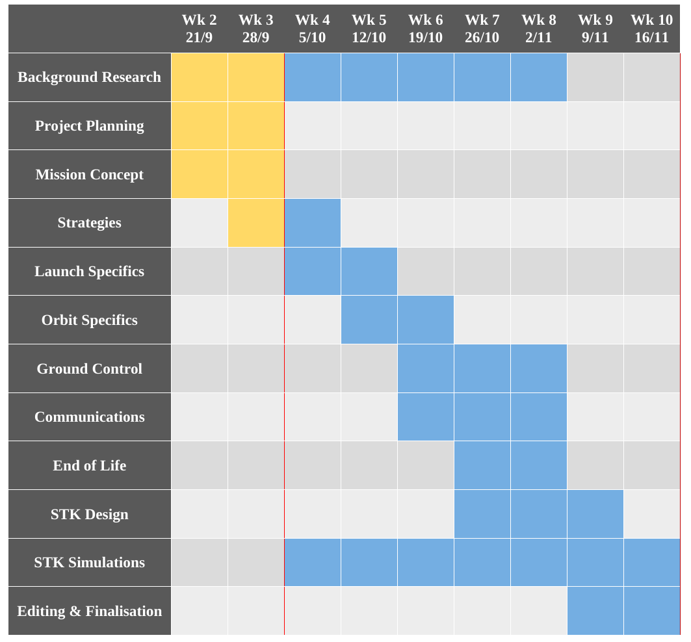

# PRELIMINARY REPORT

AERO9500 – SATELLITE SYSTEMS

T3 2020

## Mission Concept & Rationale

Coral reefs harbour some of the most diverse species of life on the planet, but this is not even the full extent of their nurture. Hundreds of millions of humans rely on reefs for food, natural protection, jobs, and tourism. Over the last century, human-induced environmental change – as a result of increased burning of fossil fuels and deforestation – has put huge ecosystems at risk. Oceans have become 30 percent more acidic since the industrial revolution leading to the bleaching of coral reefs.¹ These bleaching events are destructive enough to wipe out entire reefs, displacing billions of animals in the process.

Australia’s Great Barrier Reef is the largest coral reef in the world, spread over 344,400 km². It is one of the most complex, vast, and flourishing ecosystems on Earth, but it is due to suffer several more bleaching events in the coming years. In 2016, a bleaching killed 60 percent of the reef’s coral. In 2017, another 50 percent perished.²

Coral reefs, specifically the Great Barrier Reef, would immensely benefit from dedicated satellite monitoring. A near-real-time relay to monitoring stations on the ground would allow marine and conservation scientists to more accurately predict and react to coral bleaching events. Reef-monitoring satellites could also be used to report sea surface temperatures, thermal stress on coral, and bathymetry (current satellites have only mapped Great Barrier Reef depths to a resolution of 100 meters per pixel).³

Traditionally, coral bleaching was monitored by plane fly-by surveying, and then more recently by satellite temperature monitoring. However, while high temperatures can lead to coral bleaching, it is not a direct indicator that bleaching is occurring (or at what severity). A newer technology designed by ASU Professor Greg Asner has been used in Hawaii to detect colour/tone changes to the seafloor, where lighter hues indicate bleaching.⁴ This tool could be applied to a new satellite over the Great Barrier Reef.

¹ https://www.noaa.gov/education/resource-collections/ocean-coasts/ocean-acidification

² https://www.nationalgeographic.com/magazine/2018/08/explore-atlas-great-barrier-reef-coral-bleaching-map-climate-change/

³ https://www.deepreef.org/projects/48-depth-model-gbr.html

⁴ https://www.nature.com/articles/d41586-019-02802-2

## Project Plan & Preliminary Progress

Project work will be divided into weeks via a Gantt Chart. Detailed task descriptions can be found on the next page. Completed stages are gold. Incomplete stages are blue. Deadlines are indicated by red lines.

- **Background Research:** This research will be ongoing throughout almost the entire design process as I will be learning and designing in parallel. The earlier weeks will consist of researching existing satellites – including their creation, deployment, orbit, structure, and use. It will then be a process of stitching together relevant information for the most efficient design of my satellite.
- **Project Planning:** This stage consists of setting out a plan. I have laid it out in the form of a Gantt chart as seen above.
- **Mission Concept:** This should aim to explain the need for the mission, what the satellite will do, and who it can benefit. This stage is complete as part of the preliminary report.
- **Strategies:** The goal is to brainstorm and research as many possible strategies for the satellite’s launch/orbit and then gradually cut and refine them over the next few weeks – as I further explore launch and orbit. In addition to my own research, the syllabus work on astrodynamics will help me to understand and design an optimal mission.
- **Launch Specifics:** I will need to review possible launch vehicles, trajectories, and locations, then choose an optimal strategy. Running basic simulations in STK will also be useful.
- **Orbit Specifics:** My current choice is a geostationary orbit at an altitude of 600 km, which keeps the satellite fixed above the reef at all times. I will also calculate COEs & AOEs. More STK simulations needed.
- **Ground Control:** I need to determine which ground facilities to utilise, and if multiple are needed. If the satellite is only required for Australia, then maybe only one is required.
- **Communications:** This stage will consist of comparing possible communications methods to find how to maintain a signal that is near-real-time and consistent.
- **End of Life:** Need to decide how to dispose/recycle the satellite after its lifespan and how long that lifespan will be. Possible methods include de-orbiting the satellite, leaving it where it is, or propelling it out into a graveyard orbit.
- **STK Design & Simulations:** I will be designing and simulating throughout the project to better understand how each stage works. Final design and simulation should be completed by the end of week 9.
- **Editing & Finalisation:** Weeks 7 and 8 are reserved for review, amendments, final simulations, and reflection. The final report is due on 20/11/20 at 5pm.

Furthermore, in my progress, I have read the brief of Asner’s monitoring system in Hawaii, researched into how coral bleaching occurs and its severity, and also completed STK tutorials 1, 2, 3 & 4.
