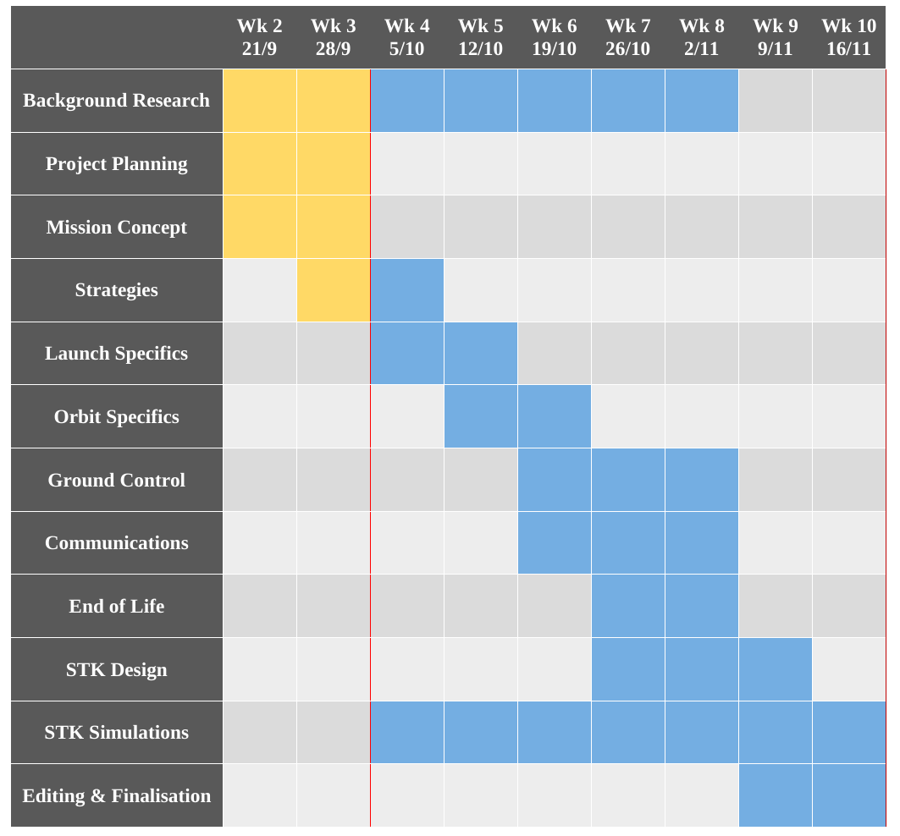

# Input_1_u - what was changed (NOT sent to any model)

UPGRADED ("_u") variant of `Input_1`. `Rubric_1.md`, `Task_1.md` are byte-identical copies of the originals; only the solution differs (`Solution_1_u.md`, derived from `Input_1/Solution_1.md`).

The report is extended to address every reason for lost marks. The student's original mission concept, Gantt chart (same image) and task descriptions are kept. Note: reference titles in the new list are descriptive, written from the URLs the student gave; they were not checked against the live pages. The hand-calculation values in Table 3 were computed for this dataset and are correct.

**Basis for the edits:** (1) the human marker's grades in `Input_1/HumanGraded/Prelim Report.pdf` (89/100: concept 9/10, plan 10/10, progress 7/10, presentation 8/10, no written comments); (2) the two earlier pipeline runs of Input_1 in `oldruns/` (plan lacks contingency and rationale for sources; progress has no calculations or orbit parameters; requirement 'supplement with hand calculations' not met); (3) the rubric's Accomplished descriptors. No CritiqueAgentv3 marking of Input_1 existed when this was made - re-check once one exists.

**Expected effect on marking:** All four criteria should sit at the top of Accomplished (roughly 90-100%). Length grows from about 800 to about 1,850 words, which is longer than the 'ideally around 2-3 pages' in the task; a marker may comment on that.

| ID | Type | Where | Change | Why / what a marker should notice |
|---|---|---|---|---|
| U1 | presentation: citations | Mission Concept & Rationale | Footnote markers replaced by numbered citations [1]-[4] that match one reference list; footnote lines removed | Rubric C4: references in text match the reference list and are cited properly (original mixed footnotes with a separate uncited link list) |
| U1b | presentation: citations | Mission Concept & Rationale | as U1 | as U1 |
| U1c | presentation: citations | Mission Concept & Rationale | as U1 | as U1 |
| U1d | presentation: citations | Mission Concept & Rationale | as U1 | as U1 |
| U2 | plan: structure, software choice, rationale | Project Plan heading and introduction | Section split into 'Project Plan' and 'Preliminary Progress'; software choice (STK) stated with a reason; explanation of why the plan is ordered this way for this mission; figure referenced by number | Task: decide which software package you are using. Rubric C2 Accomplished: 'the student makes clear why the plan is developed this way in the context of the mission' |
| U3 | presentation: figure label | Gantt chart | Figure number and caption added under the Gantt chart | Rubric C4: unlabelled figures or tables are listed under Deficient; Accomplished needs clear, consistent graphical presentation |
| U4 | plan: contingency; progress: technical content | end of Project Plan (replaces the one-sentence progress statement) | Contingency table (Table 1) and annotated information sources (Table 2) added to the plan; new 'Preliminary Progress' section with hand calculations for a candidate 600 km sun-synchronous orbit (Table 3) and their interpretation | Rubric C2 Accomplished: 'robust and has provision for project variations and contingencies ... appropriate references to information sources'. Rubric C3 Accomplished: 'good preliminary set of results included with brief description and/or interpretation'. Human marker gave Progress 7/10; old pipeline runs said 'no hand calculations, orbit parameters' |
| U5 | presentation: reference list | Useful Links (now References) | 'Useful Links' replaced by one numbered reference list with organisation, title, year, URL and access date; every entry is cited in the text; a textbook added as a planned source | Rubric C4 Accomplished: references in text match reference list (and vice versa) and are cited properly |

## Exact text changes

### U1 - Mission Concept & Rationale

Original:

> bleaching of coral reefs.¹ These

Changed to:

> bleaching of coral reefs [1]. These

### U1b - Mission Concept & Rationale

Original:

> another 20 percent perished.²

Changed to:

> another 20 percent perished [2].

### U1c - Mission Concept & Rationale

Original:

> 100 meters per pixel).³

Changed to:

> 100 meters per pixel) [3].

### U1d - Mission Concept & Rationale

Original:

> where lighter hues indicate bleaching.⁴ This tool could be applied to a new satellite over the Great Barrier Reef. ¹ https://www.noaa.gov/education/resource-collections/ocean-coasts/ocean-acidification ² https://www.nationalgeographic.com/magazine/2018/08/explore-atlas-great-barrier-reef-coral-bleaching-map-climate-change/ ³ https://www.deepreef.org/projects/48-depth-model-gbr. [...] om/articles/d41586-019-02802-2

Changed to:

> where lighter hues indicate bleaching [4]. This tool could be applied to a new satellite over the Great Barrier Reef. **Mission goal.** Give reef managers direct, repeatable observations of coral colour over the whole Great Barrier Reef, so that bleaching is detected within days instead of after a seasonal aerial survey. **Objectives and preliminary requirements.** 1. Image the [...]  need to see individual reefs.

### U2 - Project Plan heading and introduction

Original:

> ## Project Plan & Preliminary Progress Project work will be divided into weeks via a Gantt Chart. Detailed task descriptions can be found on the next page. Completed stages are gold. Incomplete stages are blue. Deadlines are indicated by red lines.

Changed to:

> ## Project Plan The design will be completed in STK (Systems Tool Kit), accessed remotely through the MECH lab 204 licence. STK was chosen because its access and coverage tools answer the two questions this mission depends on: how often the reef is seen in daylight, and how often data can be sent down to a ground station. Each STK result will be checked with a hand calculation. [...] al method depends on altitude.

### U3 - Gantt chart

Original:

> 

Changed to:

>  Figure 1: Project Gantt chart, Weeks 2 to 10 (gold = completed, blue = planned, red lines = report deadlines).

### U4 - end of Project Plan (replaces the one-sentence progress statement)

Original:

> Furthermore, in my progress, I have read the brief of Asner’s monitoring system in Hawaii, researched into how coral bleaching occurs and its severity, and also completed STK tutorials 1, 2, 3 & 4.

Changed to:

> **Contingencies.** Week 10 is float as well as editing time: no new design work is planned in it. The main risks and the planned responses are listed in Table 1. Table 1: Project risks and contingency plans. | Risk | Trigger | Response | |---|---|---| | STK remote access or licence unavailable | More than two days without access | Continue with hand calculations; fall back to t [...] ees with the hand calculation.

### U5 - Useful Links (now References)

Original:

> ## Useful Links https://coralreefwatch.noaa.gov/satellite/publications/nim_skirving_reef_vulnerability.pdf https://wwf.panda.org/our_work/our_focus/oceans_practice/coasts/coral_reefs/ http://www.gbrmpa.gov.au/the-reef/reef-facts https://oceanservice.noaa.gov/facts/coralreef-climate.html https://www.nationalgeographic.com/magazine/2018/08/explore-atlas-great-barrier-reef-coral-b [...] 6b-6fb6-443e-b84b-86b0bbdb53ac

Changed to:

> ## References [1] NOAA, "Ocean acidification," 2020. [Online]. Available: https://www.noaa.gov/education/resource-collections/ocean-coasts/ocean-acidification. [Accessed: 28 Sep. 2020]. [2] National Geographic, "Great Barrier Reef coral bleaching map," Aug. 2018. [Online]. Available: https://www.nationalgeographic.com/magazine/2018/08/explore-atlas-great-barrier-reef-coral-blea [...] ace. [Accessed: 28 Sep. 2020].
