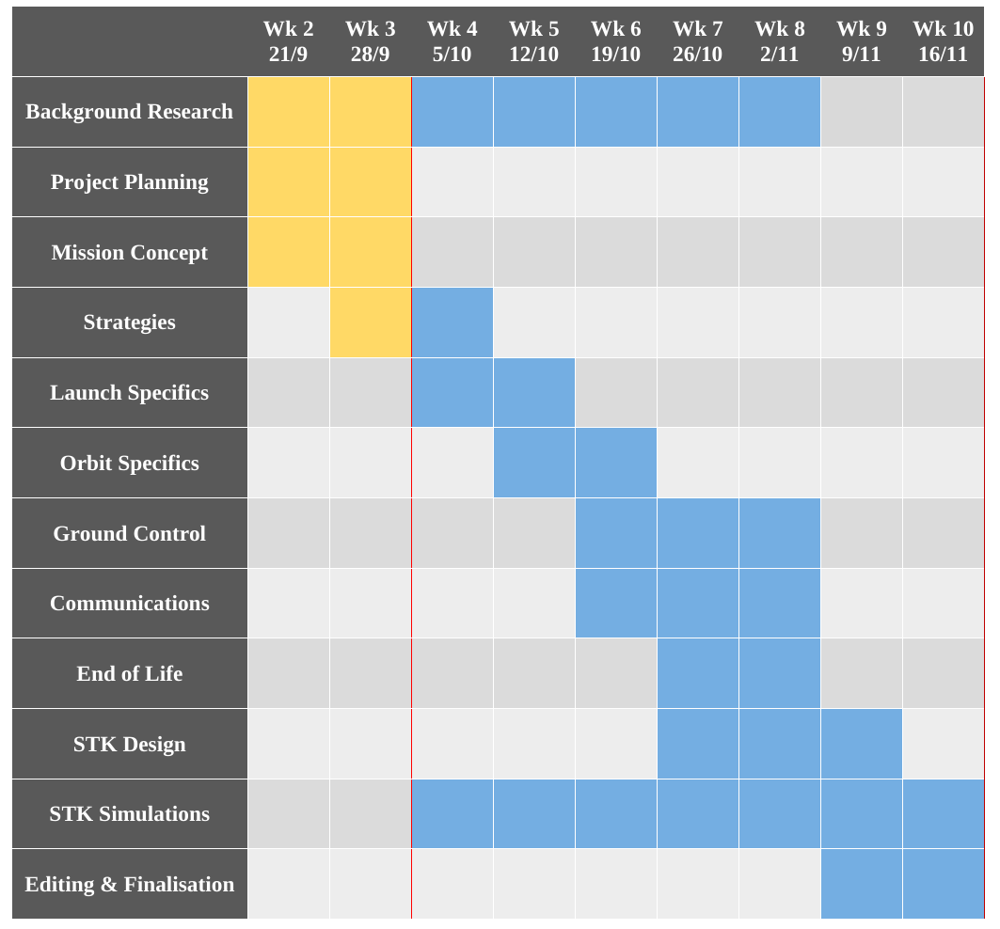

# PRELIMINARY REPORT

AERO9500 – SATELLITE SYSTEMS

T3 2020

## Mission Concept & Rationale

Coral reefs harbour some of the most diverse species of life on the planet, but this is not even the full extent of their nurture. Hundreds of millions of humans rely on reefs for food, natural protection, jobs, and tourism. Over the last century, human-induced environmental change – as a result of increased burning of fossil fuels and deforestation – has put huge ecosystems at risk. Oceans have become 30 percent more acidic since the industrial revolution leading to the bleaching of coral reefs [1]. These bleaching events are destructive enough to wipe out entire reefs, displacing billions of animals in the process.

Australia’s Great Barrier Reef is the largest coral reef in the world, spread over 344,400 km². It is one of the most complex, vast, and flourishing ecosystems on Earth, but it is due to suffer several more bleaching events in the coming years. In 2016, a bleaching killed 30 percent of the reef’s coral. In 2017, another 20 percent perished [2].

Coral reefs, specifically the Great Barrier Reef, would immensely benefit from dedicated satellite monitoring. A near-real-time relay to monitoring stations on the ground would allow marine and conservation scientists to more accurately predict and react to coral bleaching events. Reef-monitoring satellites could also be used to report sea surface temperatures, thermal stress on coral, and bathymetry (current satellites have only mapped Great Barrier Reef depths to a resolution of 100 meters per pixel) [3].

Traditionally, coral bleaching was monitored by plane fly-by surveying, and then more recently by satellite temperature monitoring. However, while high temperatures can lead to coral bleaching, it is not a direct indicator that bleaching is occurring (or at what severity). A newer technology designed by ASU Professor Greg Asner has been used in Hawaii to detect colour/tone changes to the seafloor, where lighter hues indicate bleaching [4]. This tool could be applied to a new satellite over the Great Barrier Reef.

**Mission goal.** Give reef managers direct, repeatable observations of coral colour over the whole Great Barrier Reef, so that bleaching is detected within days instead of after a seasonal aerial survey.

**Objectives and preliminary requirements.**

1. Image the full length of the reef (about 2,300 km) in visible bands at least once a week in cloud-free conditions.
2. Resolve colour change at reef scale: a ground sample distance of 10 m or better, to be refined against the method in [4].
3. Deliver each image to an Australian ground station within 24 hours of capture.
4. Operate for at least five years, so that several summer bleaching seasons are covered.

**Users and their needs.** The satellite would be operated by the Australian Institute of Marine Science (AIMS). Its customers are the Great Barrier Reef Marine Park Authority, which needs up-to-date bleaching maps to decide where to send survey and response teams [5]; CSIRO and university researchers, who need a consistent multi-year record (objective 4); and the Bureau of Meteorology, which can combine the images with its sea surface temperature products [6]. Objectives 1 and 3 come directly from the managers' need to react within days, and objective 2 from the researchers' need to see individual reefs.

## Project Plan

The design will be completed in STK (Systems Tool Kit), accessed remotely through the MECH lab 204 licence. STK was chosen because its access and coverage tools answer the two questions this mission depends on: how often the reef is seen in daylight, and how often data can be sent down to a ground station. Each STK result will be checked with a hand calculation.

Project work is divided into weeks in the Gantt chart in Figure 1, and each task is described below it. Completed stages are gold. Incomplete stages are blue. Deadlines are indicated by red lines. The order follows the mission: the imaging requirements (objectives 1 and 2) fix the orbit altitude and local time, so orbit work comes before ground control and communications, whose contact times depend on the chosen orbit. End of life is left until the orbit is fixed because the disposal method depends on altitude.

Figure 1: Project Gantt chart, Weeks 2 to 10 (gold = completed, blue = planned, red lines = report deadlines).

- **Background Research:** This research will be ongoing throughout almost the entire design process as I will be learning and designing in parallel. The earlier weeks will consist of researching existing satellites – including their creation, deployment, orbit, structure, and use. It will then be a process of stitching together relevant information for the most efficient design of my satellite.
- **Project Planning:** This stage consists of setting out a plan. I have laid it out in the form of a Gantt chart as seen above.
- **Mission Concept:** This should aim to explain the need for the mission, what the satellite will do, and who it can benefit. This stage is complete as part of the preliminary report.
- **Strategies:** The goal is to brainstorm and research as many possible strategies for the satellite’s launch/orbit and then gradually cut and refine them over the next few weeks – as I further explore launch and orbit. In addition to my own research, the syllabus work on astrodynamics will help me to understand and design an optimal mission.
- **Launch Specifics:** I will need to review possible launch vehicles, trajectories, and locations, then choose an optimal strategy. Running basic simulations in STK will also be useful.
- **Orbit Specifics:** I will need to choose an optimal orbit path and altitude, and also calculate COEs & AOEs. More STK simulations needed.
- **Ground Control:** I need to determine which ground facilities to utilise, and if multiple are needed. If the satellite is only required for Australia, then maybe only one is required.
- **Communications:** This stage will consist of comparing possible communications methods to find how to maintain a signal that is near-real-time and consistent.
- **End of Life:** Need to decide how to dispose/recycle the satellite after its lifespan and how long that lifespan will be. Possible methods include de-orbiting the satellite, leaving it where it is, or propelling it out into a graveyard orbit.
- **STK Design & Simulations:** I will be designing and simulating throughout the project to better understand how each stage works. Final design and simulation should be completed by the end of week 9.
- **Editing & Finalisation:** Week 10 is reserved for review, amendments, final simulations, and reflection. The final report is due on 20/11/20 at 5pm.

**Contingencies.** Week 10 is float as well as editing time: no new design work is planned in it. The main risks and the planned responses are listed in Table 1.

Table 1: Project risks and contingency plans.

| Risk | Trigger | Response |
|---|---|---|
| STK remote access or licence unavailable | More than two days without access | Continue with hand calculations; fall back to the STK demo version, or PIGI after registering for a licence |
| No single orbit meets weekly coverage at 10 m | Orbit trade not closed by end of Week 6 | Relax objective 1 to fortnightly coverage, or assess a second satellite in the same orbit plane |
| A stage slips by more than one week | Gantt review each Friday | Drop the secondary bathymetry product and keep the bleaching mission only |
| Other course deadlines in Weeks 7 and 8 | Known in advance | Ground control and communications are started in Week 6 so they can absorb a slow week |

**Information sources.** Table 2 lists the sources I plan to use and what each is for.

Table 2: Planned information sources.

| Source | Planned use |
|---|---|
| AERO9500 lecture notes (astrodynamics, launch, ground segment) | Method for every hand calculation |
| Wertz, Everett and Puschell, *Space Mission Engineering: The New SMAD* [7] | Orbit selection, coverage and end-of-life guidelines |
| STK tutorials and help files | Building and checking the simulations |
| NOAA Coral Reef Watch [8] and Asner's Hawaii mapping [4] | Imaging requirements: what resolution and revisit detect bleaching |
| GBRMPA reef facts [5] and eAtlas / Deepreef data [3], [9] | Geometry of the reef and what data already exists |

## Preliminary Progress

Background reading is complete for the mission concept: Asner's monitoring system in Hawaii [4], how bleaching occurs and its severity [1], [10], and existing satellite monitoring of reefs [8], [11]. STK tutorials 1, 2, 3 and 4 are complete.

I have also made first hand calculations for a candidate orbit, a circular sun-synchronous orbit at 600 km altitude (Table 3), using μ = 398,600 km³/s² and an Earth radius of 6,378 km.

Table 3: Preliminary hand calculations for the candidate orbit.

| Quantity | Calculation | Result |
|---|---|---|
| Semi-major axis | a = 6,378 + 600 | 6,978 km |
| Period | T = 2π√(a³/μ) | 5,801 s = 96.7 min |
| Orbits per day | 86,400 / 5,801 | 14.9 |
| Inclination for sun-synchronism | nodal precession of 0.9856° per day due to J2 | 97.8° |
| Ground-track shift per orbit at the equator | 360° × T / 86,164 s | 24.2° ≈ 2,700 km |
| Swath at 10 m sampling | 10 m × 6,000 pixels across track | 60 km |

Interpretation: the reef is up to about 250 km wide, so a 60 km swath needs at least five neighbouring passes to cover its widest part, and neighbouring ground tracks are 2,700 km apart on the same day. Weekly coverage (objective 1) is therefore not guaranteed by one satellite at this altitude and resolution. This swath-against-resolution trade is the main question for the Strategies and Orbit Specifics stages, and it is the reason for the second contingency in Table 1. A first STK scenario with this orbit has been set up, and its period agrees with the hand calculation.

## References

[1] NOAA, "Ocean acidification," 2020. [Online]. Available: https://www.noaa.gov/education/resource-collections/ocean-coasts/ocean-acidification. [Accessed: 28 Sep. 2020].

[2] National Geographic, "Great Barrier Reef coral bleaching map," Aug. 2018. [Online]. Available: https://www.nationalgeographic.com/magazine/2018/08/explore-atlas-great-barrier-reef-coral-bleaching-map-climate-change/. [Accessed: 28 Sep. 2020].

[3] Deepreef Explorer, "Depth model for the Great Barrier Reef (gbr100)." [Online]. Available: https://www.deepreef.org/projects/48-depth-model-gbr.html. [Accessed: 28 Sep. 2020].

[4] Nature, news article on mapping coral bleaching in Hawaii from the air, 2019, doi: 10.1038/d41586-019-02802-2. [Online]. Available: https://www.nature.com/articles/d41586-019-02802-2. [Accessed: 28 Sep. 2020].

[5] Great Barrier Reef Marine Park Authority, "Reef facts." [Online]. Available: http://www.gbrmpa.gov.au/the-reef/reef-facts. [Accessed: 28 Sep. 2020].

[6] NOAA National Ocean Service, "How does climate change affect coral reefs?" [Online]. Available: https://oceanservice.noaa.gov/facts/coralreef-climate.html. [Accessed: 28 Sep. 2020].

[7] J. R. Wertz, D. F. Everett, and J. J. Puschell, Eds., *Space Mission Engineering: The New SMAD*. Hawthorne, CA, USA: Microcosm Press, 2011.

[8] NOAA Coral Reef Watch, report on satellite monitoring of reef vulnerability. [Online]. Available: https://coralreefwatch.noaa.gov/satellite/publications/nim_skirving_reef_vulnerability.pdf. [Accessed: 28 Sep. 2020].

[9] eAtlas, Great Barrier Reef dataset record. [Online]. Available: https://eatlas.org.au/data/uuid/200aba6b-6fb6-443e-b84b-86b0bbdb53ac. [Accessed: 28 Sep. 2020].

[10] WWF, "Coral reefs." [Online]. Available: https://wwf.panda.org/our_work/our_focus/oceans_practice/coasts/coral_reefs/. [Accessed: 28 Sep. 2020].

[11] "Monitoring coral reefs from space," ResearchGate publication 231179724. [Online]. Available: https://www.researchgate.net/publication/231179724_Monitoring_Coral_Reefs_from_Space. [Accessed: 28 Sep. 2020].
