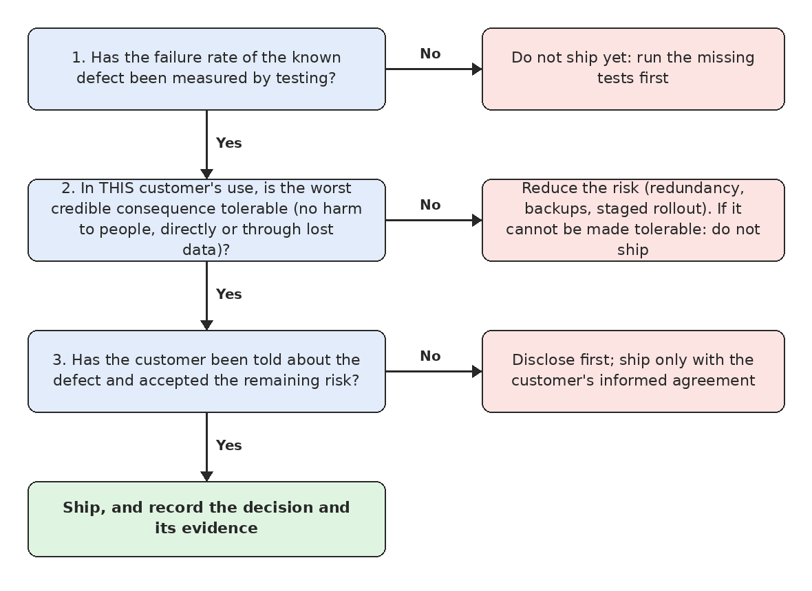

# ETHICS REPORT: To Ship or Not to Ship

#### ABSTRACT

This report examines the dilemma of a quality assurance engineer, Rachel, who must decide whether to release servers with a known higher likelihood of data-loss failures, now that a government health department intends to buy them. The arguments for shipping (time-to-market advantage, revenue and jobs, learning for later contracts) and against shipping (harm to patients, professional duty, long-term cost to the business) are weighed for each stakeholder, using the Engineers Australia Code of Ethics and four external cases: the WannaCry outage in the National Health Service, the Therac-25 accidents, the Intel Pentium division flaw and the Volkswagen emissions scandal. The report argues that shipping on the current basis is not an ethical way to conduct business, proposes an explicit rule for deciding when a product with known defects may be shipped, and recommends that Rachel withholds quality sign-off for the health contract and escalates, with separate recommendations for her company, the health department and the chip supplier.

#### INTRODUCTION

Engineering design always trades quality against cost and time, and that trade becomes an ethical question when the people who carry the risk are not the people who make the decision. In this case [1], Rachel is a Quality Assurance Engineer at an electronics company that releases a new server about every six months. The schedule leaves too little time to run every test, so she applies a personal rule: she never ships a product that could cause physical harm, but she will ship one with a higher likelihood of data loss, because a competitor otherwise would.

Three ethical issues follow. First, test coverage is being set by the release calendar instead of by risk, which is a design-process decision made by the organisation and not by Rachel alone. Second, the rule treats data loss as harmless, which stops being true once the customer is a government health department whose hospitals and emergency services depend on the servers. Third, there is a conflict of interest: the contract brings revenue and job security to the same people who decide whether the product is good enough, and nothing in the case says that the customer will be told about the defect.

These issues affect the stakeholders differently. Table 1 summarises who they are, what each has at stake and what each can decide.

Table 1: Stakeholders, their interests and the decision each controls.

| Stakeholder | Interest (what they gain or lose) | Decision they control |
|---|---|---|
| Rachel (QA engineer) | Job security and professional integrity; responsibility if harm follows | Whether to give quality sign-off; whether to escalate |
| Company management and shareholders | Revenue, growth and the six-month cadence; recall, legal and reputational cost | Release schedule, test resources, what is disclosed |
| Chip supplier | Continued volume orders; shared blame if its chips are implicated | The test data and delivery dates it offers |
| Government health department | Affordable, timely servers; continuity of clinical systems | Acceptance criteria, backups, whether to buy |
| Patients, clinicians and the public | Safe and timely care | None, so engineers must weigh their interests for them |
| Product engineers and later international customers | Field data to improve designs; inherited defects | Design changes for later generations |

### DISCUSSION: To Ship or Not to Ship

##### Arguments for shipping

Shipping on time protects a real competitive advantage. Stalk showed that firms which shorten their development cycles gain market share and margin over slower rivals [2], and in Rachel's market a missed six-month slot hands the sale to a competitor. For management and employees this is not greed: the health contract brings significant revenue, growth and job security, and a company that fails commercially protects nobody. There is also a design argument. Deploying at scale would give the product engineers the field data they need to make safety improvements before the larger international contracts. Finally, no product is free of defects, so some remaining risk must always be accepted; refusing to ship anything imperfect is not a workable standard.

These arguments are sound for ordinary customers, but each one weakens for this contract. The competitor argument assumes the buyer cannot tell the products apart; a health department that is told the failure rates can choose for itself, which removes the reason to conceal them. The learning argument uses hospitals as a test bed without their consent. The revenue argument holds only if the defect never causes a costly failure, and the cases below suggest that is a poor bet.

##### Arguments against shipping

The strongest objection is harm to people who have no say. Rachel's rule separates physical harm from data loss, but in healthcare the two are linked. When the WannaCry ransomware made data unavailable in the National Health Service in May 2017, no medical device malfunctioned, yet at least 81 of 236 hospital trusts in England were disrupted, an estimated 19,000 appointments were cancelled and patients in five areas were diverted to more distant emergency departments [3]. The cause there was an attack and not a hardware defect, so the case cannot predict how often Rachel's servers would fail; what it shows is the consequence when clinical data becomes unavailable. The Therac-25 radiotherapy accidents show the same pattern from the manufacturer's side: the supplier trusted incomplete testing and at first denied that its machine could be at fault, and six patients received massive overdoses [4].

Professional duty points the same way. The Engineers Australia Code of Ethics asks engineers to act on the basis of adequate knowledge, to communicate honestly and effectively with those who rely on their expertise, and to foster the health, safety and wellbeing of the community [5]. Signing off servers for hospital use without the tests that would establish their failure rate, and without telling the buyer, would breach all three.

The business case is also weaker than it looks. Intel found the Pentium division flaw in 1994, judged it too rare to matter and kept shipping; when customers discovered it, Intel had to offer replacements and took a charge of US$475 million [6]. Volkswagen's concealment of emissions defects in about 11 million vehicles ended in a guilty plea and US$4.3 billion in United States penalties alone [7]. Volkswagen's case was deliberate fraud, which Rachel's is not, but both cases show that a concealed defect can cost far more than the revenue it protected.

##### How should Rachel decide when to ship?

Neither "never ship a defect" nor "ship unless someone could be physically hurt" is adequate. A defensible rule assesses each known defect by the severity and the likelihood of its consequences in the customer's actual use, as risk management standards require [8], and then asks whether the customer has accepted what remains. Figure 1 sets this out.

Figure 1: Proposed decision rule for shipping a product with a known defect.

Applied to the health contract, the rule stops at the first two questions: the failure rate has not been measured because tests were skipped, and the worst credible consequence in a hospital is harm to patients. Applied to an ordinary business customer with backups, the same defect could pass if it is disclosed. Table 2 compares the options that are open for the health contract and the trade-offs between them.

Table 2: Options for the health contract.

| Option | Benefit | Cost or risk | Who carries the risk |
|---|---|---|---|
| A. Ship on schedule without disclosure | Revenue and cadence kept | Unmeasured failure risk in hospitals; breach of the Code; recall and legal exposure | Patients and the health department |
| B. Ship with disclosure and agreed safeguards (redundant servers, backups, staged rollout) | Revenue kept; customer chooses knowingly; field data still gathered | Lower margin; customer may decline | Shared, by consent |
| C. Delay this contract until the skipped tests are run | Risk is measured before use | Late delivery; a competitor may win | The company |
| D. Decline the contract | No patient exposure | Revenue and learning lost | The company and its employees |

##### The Most Ethical Path

Options B and C respect every stakeholder's interests better than either extreme. They keep most of the commercial benefit that the arguments for shipping rely on, while moving the risk from patients, who cannot consent, to the company and an informed customer, who can. Shipping on the current basis is therefore not an ethical way to conduct business. The reason is not that a rule forbids it, but that it passes an unmeasured risk to the people least able to refuse it.

#### CONCLUSION

Rachel's dilemma is a common one: commercial pressure sets the test schedule, and the engineer is left to decide what is good enough. For most customers her rule of thumb is a reasonable compromise. For a health department it is not, because data loss in a hospital can become harm to patients, as the WannaCry outage showed, and because the failure rate of these servers has not been measured. The Pentium and Volkswagen cases show that concealing a known defect also fails on commercial grounds. The ethical course is to ship only when the risk has been measured, reduced where practical and accepted by an informed customer. On the facts given, that condition is not yet met.

### RECOMMENDATIONS

1. Rachel should withhold quality sign-off for the health contract, record the untested failure modes in writing and escalate to management. Declining the contract is not her decision; certifying the product is.

2. Company management should fund the skipped tests for this contract, disclose the measured failure rates to the health department and offer safeguards such as redundant servers and a staged rollout (option B, or option C if the tests cannot be finished in time). If the six-month cadence cannot support this, health customers should be supplied from a separately tested release on a longer cycle.

3. The health department should write acceptance criteria for availability and data integrity into the contract and require test evidence before deployment.

4. The chip supplier should provide its own test data early enough for the servers to be tested against it.

5. The product engineers should take their field data from disclosed, lower-risk deployments, not from hospitals, before the international contracts.

References

[1] C. Bartlett, "To ship or not to ship," Markkula Center for Applied Ethics, Santa Clara University, Aug. 26, 2015. [Online]. Available: https://www.scu.edu/ethics/focus-areas/more-focus-areas/engineering-ethics/engineering-ethics-cases/to-ship-or-not-to-ship/. [Accessed: Jun. 10, 2024].

[2] G. Stalk, "Time—the next source of competitive advantage," *Harvard Business Review*, vol. 66, no. 4, pp. 41–51, Jul.–Aug. 1988.

[3] National Audit Office, "Investigation: WannaCry cyber attack and the NHS," HC 414, Session 2017–2019. London, U.K.: National Audit Office, Oct. 2017.

[4] N. G. Leveson and C. S. Turner, "An investigation of the Therac-25 accidents," *Computer*, vol. 26, no. 7, pp. 18–41, Jul. 1993.

[5] Engineers Australia, *Code of Ethics and Guidelines on Professional Conduct*. Canberra, Australia: Engineers Australia, 2022.

[6] Intel Corporation, *1994 Annual Report*. Santa Clara, CA, USA: Intel Corporation, 1995.

[7] U.S. Department of Justice, "Volkswagen AG agrees to plead guilty and pay $4.3 billion in criminal and civil penalties," press release, Jan. 11, 2017.

[8] Standards Australia, *AS ISO 31000:2018 Risk Management—Guidelines*. Sydney, Australia: Standards Australia, 2018.
